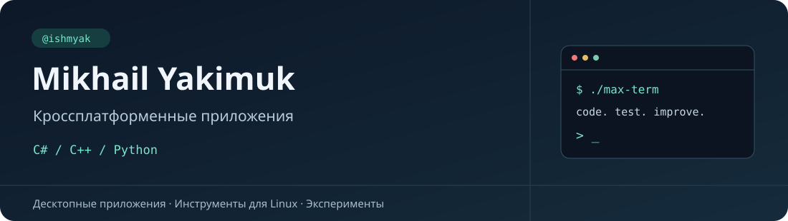

  

  <a href="https://github.com/ishmyak/max-term"><b>MAX Term</b></a> ·
  <a href="https://github.com/ishmyak/trayicon"><b>Tray Monitor</b></a> ·
  <a href="https://github.com/ishmyak?tab=repositories">Все репозитории</a>

## Обо мне

Я **Mikhail Yakimuk**, **Senior C++ разработчик**. Профессионально занимаюсь
кроссплатформенной разработкой десктопных приложений для **Windows и Linux**.

Основной язык — **C++**. Также работаю с **C#** и создаю приложения и инструменты
на **Python**. В публичных репозиториях делюсь собственными утилитами,
экспериментами и учебными материалами.

**Стек:** C++ · C# · Python · Desktop · Windows · Linux.

## Основные проекты

### [MAX Term →](https://github.com/ishmyak/max-term)

**Переписка в MAX прямо из терминала.** Независимый клиент с двухпанельным
интерфейсом: чаты и поиск слева, сообщения и ввод справа.

- Личный аккаунт с QR/SMS-входом, отдельные черновики и входящие сообщения.
- Реакции, отправка изображений и просмотр в kitty.
- Клавиатура и мышь, ссылки, копирование текста и диагностический журнал.

`Python` · `prompt_toolkit` · `PyMax` · `asyncio`

[Установка и запуск](https://github.com/ishmyak/max-term#быстрый-старт) ·
[Подробное руководство](https://github.com/ishmyak/max-term/blob/main/docs/usage.md) ·
[Сообщить об ошибке](https://github.com/ishmyak/max-term/issues)

> Использует неофициальный протокол личного аккаунта MAX; совместимость зависит
> от изменений сервера. Для знакомства без входа есть деморежим.

### [Tray Monitor →](https://github.com/ishmyak/trayicon)

**Загрузка процессора и памяти всегда под рукой.** Две небольшие иконки
с графиками в системном трее, без отдельного окна мониторинга.

- Обновление раз в секунду и история последних 32 измерений.
- Подсказки с показателями CPU и RAM, адаптация цветов к панели.
- Установка, автозапуск и управление процессом одним скриптом.

`Python` · `PyQt5` · `psutil` · `Linux`

[Установка](https://github.com/ishmyak/trayicon#установка-и-запуск) ·
[Сообщить об ошибке](https://github.com/ishmyak/trayicon/issues)

Основное окружение проекта — Astra Linux с Fly; для других рабочих столов
необходим системный трей, доступный через Qt.

## Учебные материалы

[**cpp_course**](https://github.com/ishmyak/cpp_course) — рабочий fork материалов
[softboxdev/cpp_course](https://github.com/softboxdev/cpp_course): основы C++,
сборка, Linux API, потоки и синхронизация. В README собрана навигация по теории,
практике и примерам. Это учебный репозиторий, а не самостоятельный авторский курс.

## Ранние эксперименты

[**regressio**](https://github.com/ishmyak/regressio) — архивный прототип
Telegram-бота на PHP: новости Томска, погода и курсы валют. Сохранён как ранний
эксперимент; для эксплуатации требует доработки.

---

Нашли ошибку или хотите предложить улучшение? Откройте **Issue в соответствующем
репозитории** и опишите ожидаемое поведение, окружение и шаги воспроизведения.
